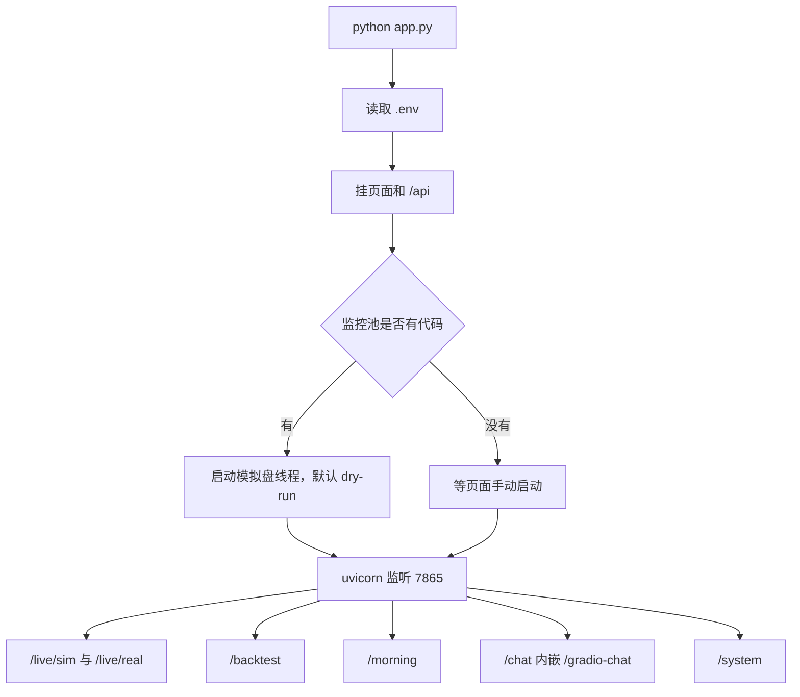
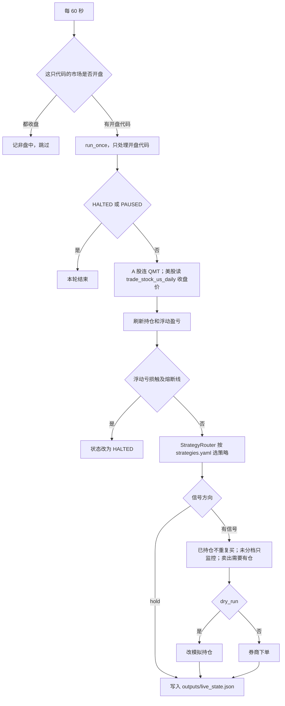
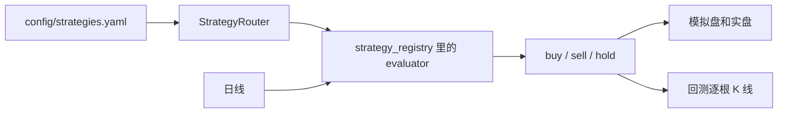
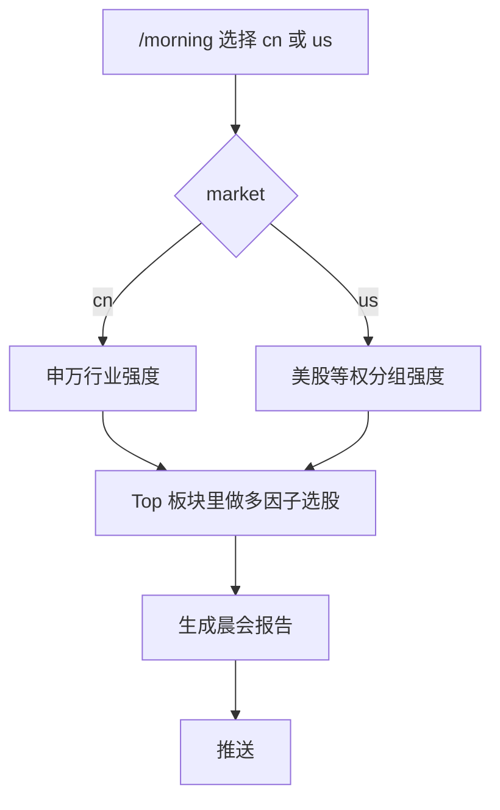
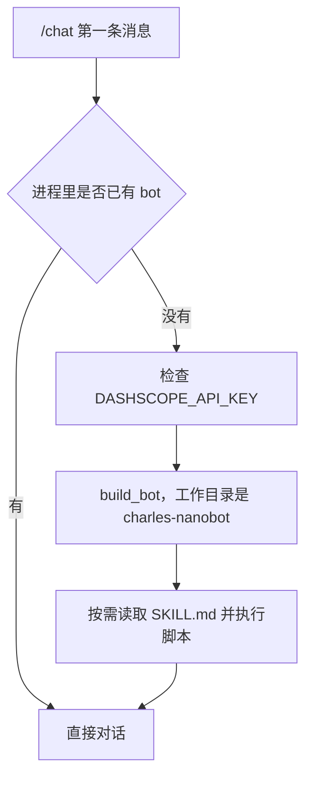

# 实盘作战与 CEO 控制台

A 股和美股共用的量化工作台。一个进程里放投研对话、晨会、回测、模拟盘和龙头战法。

浏览器默认打开 [http://localhost:7865](http://localhost:7865)，入口会转到实盘监控。

## 目录

| 目录 | 作用 |
|------|------|
| `CASE-AI量化系统/` | Web 控制台，`python app.py` 启动 |
| `CASE-龙头战法/` | 龙头战法的独立筛选和回测脚本，说明见该目录的 README |

## 启动

```powershell
cd CASE-AI量化系统
pip install -r requirements.txt
Copy-Item .env.example .env
python app.py
```

`.env` 留在本机，不进仓库。至少填上自己的 `WUCAI_SQL_PASSWORD`。投研对话还要在系统环境变量里设置 `DASHSCOPE_API_KEY`。`TRADER_DRY_RUN=1` 时不下真单。

日线在 MySQL 库 `wucai_trade`：A 股表 `trade_stock_daily`，美股表 `trade_stock_us_daily`。

## 页面

| 路径 | 内容 |
|------|------|
| `/live` | 模拟盘与实盘监控、持仓、信号 |
| `/backtest` | 单股历史回测 |
| `/morning` | 晨会。A 股走申万，美股走等权行业分组 |
| `/chat` | Charles 投研对话 |
| `/system` | 组件健康检查 |

## 策略

策略在 `CASE-AI量化系统/lib/strategy_registry.py` 注册，`config/strategies.yaml` 按股票绑定。回测、模拟盘、实盘走同一套评估。

当前包括：`macd_1d`、`ma20_hold`、`multi_factor_top`、`dragon_picker_v1`、`dragon_picker_v2`、`rsi_reversal`、`boll_revert`、`bias_revert`、`turtle_donchian`、`grid_classic`、`chan_buy1`、`chan_buy2`、`chan_buy3`、`chan_buy2_ml`、`ml_xgb`、`ml_lgb`。

美股代码用 `COHR.US` 这种后缀。日线只读 `trade_stock_us_daily`，下单单位是 1 股，不套 A 股的涨跌停、印花税和 T+1。模拟盘只在对应市场的交易时段轮询。

## 代码流程

`app.py` 起一个进程。页面和接口挂在 FastAPI 上，模拟盘是后台线程，投研对话是另一条链，不读 `strategies.yaml`。



模拟盘每 60 秒看一次交易时段。A 股和美股各自判断，两边都收盘就整轮跳过。开盘的代码才进入 `LiveTradingLoop.run_once`。



回测和实盘调用同一批 evaluator。区别只在数据从哪来、以及回测会先预热再逐根 K 线调用。



日线来源：`.US` 只读 `trade_stock_us_daily`。A 股走 QMT 或 `trade_stock_daily`。`chan_*` 回测预热至少 500 根，`ml_xgb` / `ml_lgb` 至少 250 根。`chan_buy2_ml` 和两个概率模型在回测开走之前训练一次，结果挂在当次回测的 market 上。

晨会是一条固定的四步图，市场只改变第一步的板块口径。



投研对话不参与下单。第一条消息才加载 Charles，之后缓存在进程里。技能来自 `third_party/charles_bundle/charles-nanobot/skills/*/SKILL.md`。



## 不入库的内容

账户、数据库密码和 API Key 在本机 `.env`。模拟盘股数和成本在 `config/mock_positions.yaml` 与 `outputs/live_state.json`。课件 PDF、券商研报和财报原文也不在这个仓库里。
